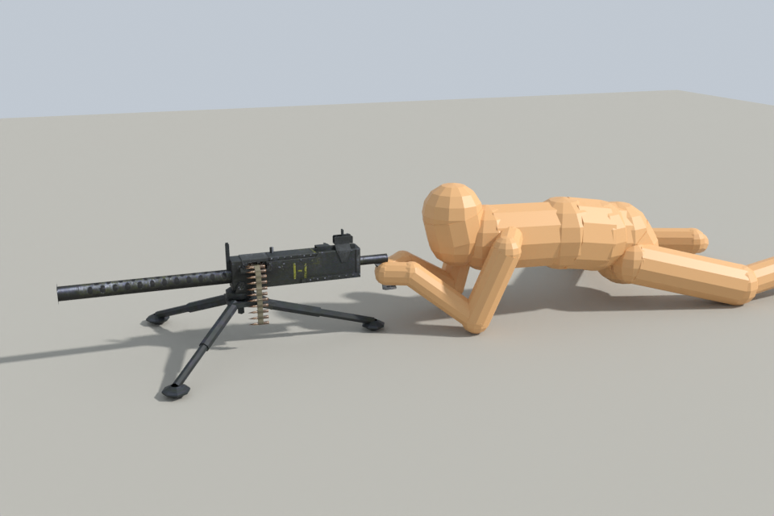
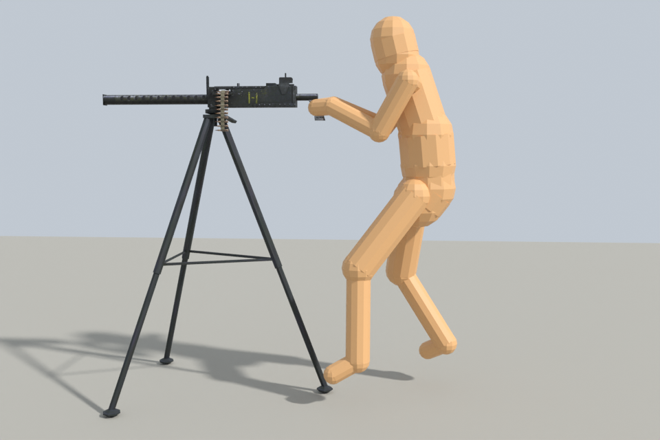

# M1919 Browning Front Sights

## Description:
This mod adds the missing flip-up front sights to the M1919 Browning. This affects both the fixed version and the one on the desert Jeep.

It also adds two new stationary versions of the same gun, for mission makers. They are the M1919A4's equivalents of the game's `w_mg42Lie` and `w_mg42Stand`:

| Model | Gunner | Mount |
|---|---|---|
| `w_1919Lie` | lying | the tripod at its lowest, bore 0.24 m off the ground |
| `w_1919Stand` | standing | the tripod on long legs with spreader bars, bore 1.42 m off the ground |

This mod is compatible with both the unmodded game and Sasha's New Weapons Mod.

## Installation:
- Extract the Models folder into your game folder.
- If you use `w_1919Lie`, extract the Tables folder too.
- Enjoy! :-)

`Tables/anim.sav` is Sabre Squadron's file with one gunner pose added (see below). If another mod ships its own `anim.sav`, make the same one-name change in that file instead.

## Using the new models in a mission

Place them like `w_1919Crouch`: a `StaticWeapon` actor whose frame loads the model, firing item 34 with ammunition item 202.

Both can replace an MG 42 of the same stance in place, and both stand on their own legs. The MG 42 models float above the ground and rely on the mission to put something under them. `w_1919Stand`'s pivot is exactly where `w_mg42Stand`'s is, and on a wall its legs are simply hidden inside. Its gunner stands 0.32 m closer to the wall than the MG 42's. `w_1919Lie`'s gunner lies where `w_mg42Lie`'s does, and its muzzle ends 4 cm further forward.

| | up / down | left / right | gunner pose |
|---|---|---|---|
| `w_1919Lie` | 8° / 12° | 45° | `(mg42lie` |
| `w_1919Stand` | 15° / 5° | 30° | `(w97_stand` |

`w_1919Stand` has `w_mg42Stand`'s limits. `w_1919Lie` depresses less than `w_mg42Lie` (15°) because its pivot is 0.55 m behind the muzzle, not 0.17 m, so 15° would bring the muzzle within 10 cm of the ground.

## How they work

- **The gun is unchanged.** Everything from `BARREL00_00` down, including the front sight and `cameraFPV`, is the same as in `w_1919Crouch`. The shot animation is the same file under two new names. So the sight picture is identical: the top of the blade is at the centre of the screen, through the rear aperture.
- **The gunner's pose comes from a table in `anim.sav`**, at index *projectile type + 3 × stance*. The M1919 is type 1. Its row has a standing and a crouching pose, but its prone slot (7) is empty, so a prone gunner would get no body pose. `Tables/anim.sav` fills slot 7 with `(mg42lie`. No shipped gun reads that slot: the guns at lying seats are all types 0 or 2. Sasha's mod ships `items.sav` but no `anim.sav`, so the two don't conflict. Changing the item's type instead would have meant shipping `items.sav`, and would have changed the crouching gun's pose.
- **The grips are placed for the pose.** `tools/pose_fit.py` checks both hands at all six of the pose's aim extremes, and they are within reach at every one. The soldier stays at least 0.17 m from the tripod's legs.
- **The tripod** keeps `w_1919Crouch`'s head (the plate under the gun) and gets new legs modelled on photos of the real tripod: telescoping tubes and cup feet standing on their points. It uses the gun's own texture, so there are no new maps. Levels of detail switch at the old tripod's distances. The third-person cameras keep the MG 42's distance from the pivot.
- **`stupacka01` is left out.** It is a triangle on the ground that nothing in the exe reads.

The tripod's height is a compromise. A real tripod at its lowest holds the bore at about 0.3 m. The game's prone pose keeps the head at about 0.3 m, so the sights are 5 cm above it at 0.35 m, with the bore at 0.24 m.

## Trying them in the Tutorial

`test_lie` and `test_stand` each hold a `Missions/TUTORIAL/actors.bin` that swaps the Tutorial's Browning for that model. Copy one `Missions` folder into the game folder along with `Models` and `Tables`, and remove it afterwards to get the normal Tutorial back.

The Tutorial's firing counter is 0.43 m high, right in front of the gun. So in `test_lie` the gun sits on top of the counter and its gunner hovers over the floor behind it. That is only for the test. In `test_stand` the legs pass through the counter.

Checked offline only so far: the files round-trip through the tools, nothing comes within the game's 0.1 m near clip in first person at the aim extremes, and `previews/` shows renders from the game's camera dummies. They have not been tried in game yet.




In these two renders the orange figure stands in for the gunner: the game's pose file, with the arms reaching for the grips.

## Rebuilding

```
python tools/build_stances.py
python tools/pose_fit.py fit
python tools/make_previews.py
```

`build_stances.py` starts from `Models/w_1919Crouch.4ds` and reads the shot animation from `H:/HD2_Unpacked` and `anim.sav` and the Tutorial from `H:/HD2_Unmodified`. The previews need Blender 4.1.
